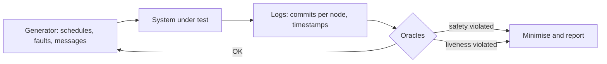

# Why Consensus Bugs Matter

Consensus protocols are proven safe on paper; implementations are not. A consensus bug can cause a **safety failure** (conflicting blocks finalised, a chain split) or a **liveness failure** (the chain halts). Both have happened in production blockchains and in classic distributed databases.

The consequences differ. A liveness failure is loud: blocks stop, users complain, operators restart nodes, and funds are usually safe. A safety failure can be silent: two groups of nodes each believe a different history is final, exchanges credit deposits on one side, and the damage appears only when the sides meet. Safety bugs are rarer and far more expensive.

## Bug sources

| Source | Example |
|---|---|
| Protocol-implementation gap | timeout or view-change logic deviates from the paper |
| Byzantine message handling | malformed or equivocating messages crash or confuse nodes |
| Network asynchrony | rare message orderings or delays |
| State and storage | crash recovery restores inconsistent state |
| Resource exhaustion | message floods, large messages |
| Client diversity | different implementations interpret edge cases differently |

## Why normal testing misses them

Unit tests use benign, synchronous scenarios. Bugs appear under specific interleavings, partitions and Byzantine behaviours that are astronomically unlikely in random testing without guidance.

A rough sense of scale: four nodes exchanging three message types over a few rounds already produce millions of possible delivery orders. Add crashes at any point and Byzantine choices for one node, and exhaustive testing is out of reach. The techniques in this book either control the space (deterministic simulation), shrink it (Twins scenarios, model checking with small bounds), or search it with feedback (state-aware fuzzing).

## Safety and liveness as oracles

Every technique in this book needs an **oracle**: an automatic judgement of whether a run went wrong. Two oracles cover most of the ground:

| Oracle | Check | Typical false positive |
|---|---|---|
| Safety (agreement) | no two honest nodes commit different blocks at the same height | comparing a node's tentative (unfinalised) head instead of its committed block |
| Liveness (progress) | every honest node commits something new within T once the network is healthy | choosing T shorter than the protocol's own timeouts under partition |

Precise definitions matter. "Committed" means finalised for Ethereum, committed for CometBFT, and so on. Using the wrong notion produces either false alarms or missed bugs.



## Techniques in this book

1. Deterministic simulation testing (control all nondeterminism).
2. Twins-style Byzantine emulation.
3. Network chaos (partitions, delays) on real deployments.
4. State-aware fuzzing of consensus messages.
5. Differential testing across clients.

## Worked example

> **Execution status:** The Python oracle below was executed with Python 3 while writing this chapter; the two output lines shown were observed.

Write the two oracles once; every later chapter reuses them.

```python
from collections import defaultdict

def check(logs, now, last_progress, timeout=30):
    """logs: {node: {height: block_hash}}"""
    by_height = defaultdict(dict)
    for node, commits in logs.items():
        for h, bh in commits.items():
            by_height[int(h)][node] = bh
    problems = []
    for h in sorted(by_height):
        if len(set(by_height[h].values())) > 1:
            problems.append(f"SAFETY: height {h} has conflicting commits {by_height[h]}")
    for node, t in last_progress.items():
        if now - t > timeout:
            problems.append(f"LIVENESS: {node} no new commit for {now - t}s")
    return problems or ["OK"]

logs = {"n0": {1: "aa", 2: "bb"}, "n1": {1: "aa", 2: "bb"},
        "n2": {1: "aa", 2: "cc"}, "n3": {1: "aa"}}
for p in check(logs, now=100, last_progress={"n0": 95, "n1": 96, "n2": 97, "n3": 40}):
    print(p)
```

Output:

```
SAFETY: height 2 has conflicting commits {'n0': 'bb', 'n1': 'bb', 'n2': 'cc'}
LIVENESS: n3 no new commit for 60s
```

To feed it from a real local network, collect committed block hashes per node. For a CometBFT localnet, each node's RPC serves `/block?height=H`; for an Ethereum devnet, the beacon API serves finalised headers. Poll, build the `logs` dictionary, and call `check` every few seconds. Note that n3's missing height 2 is not a safety problem; only conflicting values are.

## Common pitfalls

- **Checking heads instead of commits.** Forks of unfinalised heads are normal; only committed conflicts are safety failures.
- **Liveness timeouts tighter than the protocol's.** You will "find" bugs that are designed behaviour.
- **Including Byzantine nodes in the safety check.** Twins or fuzzing nodes may commit anything; check honest nodes only.
- **Discarding logs from passing runs.** Baselines from healthy runs are how you calibrate timeouts.
- **Reporting chain-split bugs publicly first.** These are critical vulnerabilities; disclose privately to the client team.

## Exercises

1. Read a public post-mortem of a blockchain halt or chain split and classify the bug source.
2. List the message types in a BFT protocol you know (e.g. Tendermint/CometBFT: proposal, prevote, precommit).
3. Describe a message interleaving that could stress a view change.
4. Connect the worked example's oracle to a local CometBFT or Ethereum devnet and run it for an hour on a healthy network to calibrate the liveness timeout.

## Further reading

- Kingsbury, Jepsen analyses: <https://jepsen.io/analyses>
- CometBFT spec: <https://github.com/cometbft/cometbft/tree/main/spec>
- Ethereum consensus specs: <https://github.com/ethereum/consensus-specs>
- Lamport, Shostak & Pease, "The Byzantine Generals Problem", ACM TOPLAS 1982
