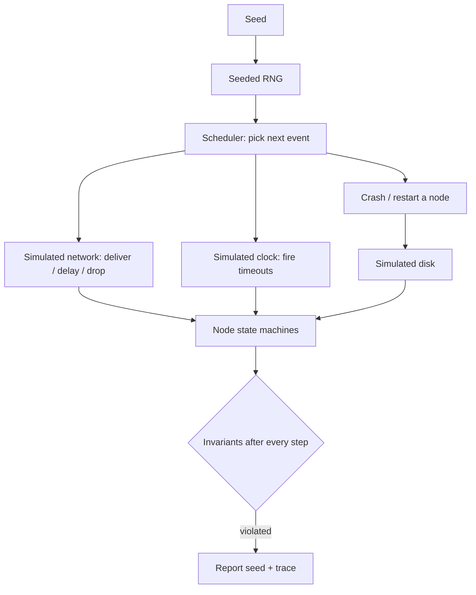

# Deterministic Simulation Testing

**Deterministic simulation testing (DST)** runs a whole distributed system inside one process with simulated network, disk and clock, driven by a seed. Any failure can be replayed exactly from its seed. FoundationDB popularised it; TigerBeetle, and the Antithesis platform (deterministic hypervisor) brought it to wider use.

The payoff is reproducibility. A real-network test that fails once in ten thousand runs is nearly impossible to debug; a simulation that fails on seed 47 fails on seed 47 every time, under a debugger, with full logging.

## Requirements

- All nondeterminism (time, randomness, threads, network, disk) goes through injectable interfaces.
- A simulator schedules events (message deliveries, timeouts, crashes) according to a seeded RNG.
- Invariant checks run continuously (e.g. no two different blocks committed at the same height).



## Faults to inject

| Fault | Simulation |
|---|---|
| Message delay/reorder/drop | scheduler policy |
| Partition | drop messages between groups for a period |
| Crash and restart | discard volatile state; restore from simulated disk |
| Disk faults | torn writes, lost fsyncs |
| Clock skew | per-node clock offsets |

Fault probabilities are a tuning knob. Too few faults and the simulator explores only the happy path; too many and nothing ever completes. Teams that use DST seriously randomise the fault rates per seed too ("swarm testing"), so some runs are calm and others chaotic.

## Retrofitting existing clients

Retrofitting DST onto an existing blockchain client is hard (pervasive use of real time and threads). Options: test a protocol core extracted as a state machine; or use a deterministic hypervisor approach that controls nondeterminism from outside.

Extraction works best when the consensus core is already written as `handle(state, event) -> (state, outputs)`. Several BFT implementations are structured this way; if yours is not, refactoring towards it is worthwhile even before simulation, because it also makes unit tests simpler.

## Worked example

> **Execution status:** The simulator below was executed with Python 3 while writing this chapter. The counts and the trace shown were observed for these exact seeds and code.

A four-node vote protocol, a seeded scheduler with crash-restart, and the classic bug: **not persisting a vote before sending it**.

The toy protocol: two competing proposals (A and B) reach all nodes in random order. Each node votes for the first proposal it sees and broadcasts the vote. A node commits a value when it has seen 3 of 4 votes for it. If votes are persisted, safety holds under any number of crashes, because quorums of 3 out of 4 overlap in at least 2 nodes and no node votes twice.

```python
import random
N, Q = 4, 3

def run(seed, persist_votes=True, crash_p=0.1):
    rng = random.Random(seed)
    disk = [None] * N                 # survives crashes
    mem = [None] * N                  # lost on crash, reloaded from disk
    votes = [dict() for _ in range(N)]
    committed = [None] * N
    msgs = [("prop", None, i, v) for v in "AB" for i in range(N)]
    while msgs:
        if rng.random() < crash_p:                       # crash-restart
            n = rng.randrange(N)
            mem[n] = disk[n]
            continue
        kind, src, dst, val = msgs.pop(rng.randrange(len(msgs)))
        if kind == "prop" and mem[dst] is None:
            mem[dst] = val
            if persist_votes:
                disk[dst] = val
            msgs += [("vote", dst, j, val) for j in range(N)]
        elif kind == "vote":
            s = votes[dst].setdefault(val, set()); s.add(src)
            if len(s) >= Q and committed[dst] is None:
                committed[dst] = val
    return {c for c in committed if c is not None}

for persist in (True, False):
    bad = [s for s in range(10_000) if len(run(s, persist)) > 1]
    print(f"persist_votes={persist}: {len(bad)} violating seeds; first={bad[:3]}")
```

Observed output:

```
persist_votes=True: 0 violating seeds; first=[]
persist_votes=False: 695 violating seeds; first=[47, 52, 55]
```

Adding print statements and replaying seed 47 gave this trace (abridged):

```
n2 votes B
n0 votes A
crash-restart n0
n3 votes B
crash-restart n2
n2 votes A
n0 votes B
n2 commits B ... n0 commits A
```

Nodes 0 and 2 each forgot their vote on restart and voted again for the other value, so both A and B reached 3 votes. Running seed 47 a second time produced the same conflicting commits, which is the reproducibility that makes DST valuable.

**Try it yourself:** set `crash_p` to 0.01 and count violating seeds again. Rare faults make bugs rare, which is why swarm testing varies the rates.

## Common pitfalls

- **Hidden nondeterminism.** Iterating over a hash map, reading the wall clock or spawning a thread breaks replay; seeds stop reproducing.
- **Invariants checked only at the end.** Check after every step, or transient violations vanish.
- **Fixed fault rates.** Some bugs need calm periods followed by bursts; randomise rates per seed.
- **Simulating a model of the code instead of the code.** The bug must be in the code you ship; extract the real state machine.
- **Discarding the seed.** Every failure report must include the seed and the code version.

## Exercises

1. Implement a toy two-phase BFT protocol as a pure state machine and simulate 4 nodes with a seeded scheduler.
2. Add partitions and crash-restart, with a safety invariant check.
3. Introduce a bug (e.g. not persisting a vote before sending it) and find it with the simulator.
4. Add a "lost fsync" fault: a write to `disk` is dropped with probability p even when `persist_votes` is true. How many seeds now fail?

## Further reading

- FoundationDB testing (Will Wilson, "Testing Distributed Systems w/ Deterministic Simulation", Strange Loop 2014)
- TigerBeetle VOPR: <https://github.com/tigerbeetle/tigerbeetle>
- Antithesis: <https://antithesis.com>
- Groce et al., "Swarm Testing", ISSTA 2012
