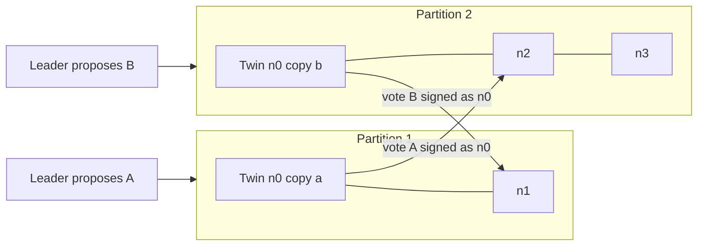

# Twins and Byzantine Emulation

Writing Byzantine (malicious) node behaviour by hand is laborious. **Twins** (Bano et al., 2022) emulates Byzantine behaviour by running **two copies of a node with the same identity and keys**. Twins can equivocate naturally (each sends its own honest messages), and combined with partitions, they reproduce many Byzantine attack patterns without custom attack code.

## How it works

1. Pick nodes to "twin" (up to the fault threshold f).
2. Generate scenarios: sequences of rounds with network partitions and leader assignments.
3. Run the real implementation in each scenario.
4. Check safety (no conflicting commits) and liveness properties.

Twins found bugs in HotStuff-family implementations during its development at Novi/Diem.

The insight is that most damaging Byzantine behaviour in BFT protocols is some form of **saying different things to different peers**: two proposals, two votes, two timeout certificates. A twin pair does exactly that, using unmodified honest code. Each copy behaves correctly given what it sees; the partition makes them see different things.



## Scenario explosion

The number of partition and leader combinations grows quickly. Twins uses bounded enumeration; fuzzing (random sampling with coverage feedback) or LLM-proposed scenarios targeting specific code paths (e.g. view-change handling) can prioritise.

When a model proposes scenarios, the harness decides: each proposed scenario is executed and judged by the safety and liveness oracles from Chapter 1. A scenario that "should" break the protocol according to the model's explanation but passes the oracles is simply a passing test.

## Beyond twins

- **Message mutation:** a Byzantine node sends syntactically valid but semantically inconsistent messages (wrong height, wrong signatures, future rounds).
- **Selective silence:** a node responds only to some peers.

| Technique | Needs custom attack code? | Finds | Misses |
|---|---|---|---|
| Twins | no | equivocation-driven safety bugs | malformed-message bugs |
| Message mutation | yes (mutators) | parser and validation bugs | coordinated multi-message attacks |
| Selective silence | little | liveness and timeout bugs | safety bugs needing equivocation |

## Worked example

> **Execution status:** The simulation and the scenario count were executed with Python 3 while writing this chapter; the numbers below were observed.

Extend the Chapter 2 toy so a node can be twinned, and confirm two things: the harness finds no violations when Byzantine nodes are within the fault threshold, and does find them when the threshold is exceeded. A harness that cannot tell those apart is not testing anything.

```python
import random
N, Q = 4, 3

def run(seed, twins):
    """Twinned nodes get two instances: copy 'A' sees only proposal A,
    copy 'B' sees only proposal B (a partition)."""
    rng = random.Random(seed)
    inst = [(n, None) for n in range(N) if n not in twins]
    inst += [(n, side) for n in twins for side in "AB"]
    voted = {i: None for i in inst}
    votes = {i: {} for i in inst}
    commit = {i: None for i in inst}
    msgs = [("prop", None, i, v) for i in inst for v in "AB" if i[1] in (None, v)]
    while msgs:
        kind, src, dst, val = msgs.pop(rng.randrange(len(msgs)))
        if kind == "prop" and voted[dst] is None:
            voted[dst] = val
            msgs += [("vote", dst[0], j, val) for j in inst]   # signed as identity
        elif kind == "vote":
            s = votes[dst].setdefault(val, set()); s.add(src)  # dedupe by identity
            if len(s) >= Q and commit[dst] is None:
                commit[dst] = val
    honest = {commit[i] for i in inst if i[0] not in twins and commit[i]}
    return len(honest) > 1

for tw in [set(), {0}, {0, 1}]:
    bad = sum(run(s, tw) for s in range(5000))
    print(f"twins={sorted(tw)}: {bad} / 5000 seeds violate safety among honest nodes")
```

Observed output:

```
twins=[]: 0 / 5000 seeds violate safety among honest nodes
twins=[0]: 0 / 5000 seeds violate safety among honest nodes
twins=[0, 1]: 964 / 5000 seeds violate safety among honest nodes
```

With n = 4 the protocol tolerates f = 1 Byzantine node. One twin pair (f = 1) never breaks safety: A needs 3 distinct signers and B needs 3 distinct signers, which requires at least 5 identities if only one equivocates. Two twin pairs exceed f, and the harness duly finds conflicting commits. Now introduce a real bug, for example counting votes in a list instead of a set keyed by identity, and see whether one twin is enough to expose it.

**Scenario counting.** With 4 nodes and 1 twin there are 5 instances. Splitting 5 instances into two non-empty groups can be done in 15 ways; adding the "no partition" case and 4 leader choices gives 64 scenarios per round, so 3 rounds give 64³ = 262,144 scenarios. That is enumerable for a fast simulator but not for a real deployment, which is why prioritisation matters.

## Common pitfalls

- **Twinning more than f nodes and calling it a bug.** Violations beyond the fault threshold are expected; check the bound first.
- **Excluding twins from the oracle incorrectly.** Twins may commit conflicting values; judge honest nodes only.
- **Partitions without leader variation.** Many bugs need a specific leader in a specific partition.
- **Ignoring liveness.** Twins scenarios also expose stalls after partitions heal.
- **Trusting model-proposed scenarios without running them.** The oracle decides, not the explanation.

## Exercises

1. Apply the Twins idea to your toy protocol from Chapter 2 and find an equivocation bug.
2. Enumerate scenarios for 4 nodes, 1 twin, 3 rounds; count them.
3. Ask a model to propose 10 scenarios that exercise view changes; run them.
4. Introduce the list-instead-of-set vote counting bug in the worked example and find the smallest twin configuration that exposes it.

## Further reading

- Bano et al., "Twins: BFT Systems Made Robust", OPODIS 2021 / arXiv:2004.10617
- Yin et al., "HotStuff: BFT Consensus with Linearity and Responsiveness", PODC 2019
- Castro & Liskov, "Practical Byzantine Fault Tolerance", OSDI 1999
