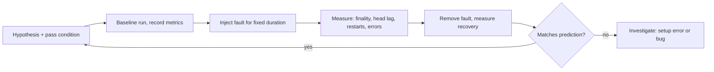

# Chaos Testing on Real Deployments

Simulation tests the protocol; chaos testing tests the deployed system with real binaries, networking and storage. It finds the bugs simulation cannot: a database that corrupts on a torn write, a client that mis-handles a real kernel's socket errors, a validator client that loses its slashing-protection file on restart.

"Real deployments" here means **your own devnets and test clusters**. Never inject faults into networks or nodes you do not operate.

## Tools

- **Kurtosis** (and Ethereum's `ethereum-package`) to spin up multi-client Ethereum devnets.
- **Chaos Mesh** / **Litmus** for Kubernetes fault injection (network delay, partition, pod kill, clock skew, I/O faults).
- **tc/netem** for Linux network emulation.
- **Jepsen** framework for distributed system tests with linearizability checking.

## Experiments

| Experiment | Expected behaviour |
|---|---|
| Partition 1/3 of validators for 10 min | finality pauses or continues per protocol; recovers after heal |
| Kill and restart a client mid-epoch | rejoins without slashing; no double votes |
| Clock skew of 5 s on some nodes | no missed duties beyond tolerance |
| Disk latency spikes | no corrupted databases after restart |
| Client mix changes | consensus holds across all client pairs |

Ethereum client teams and researchers run such tests on devnets before forks; reproducing them helps you learn the system and sometimes find bugs.

## Know the thresholds before you start

Ethereum's Casper FFG finality needs attestations from validators holding at least two thirds of active stake. That gives sharp predictions:

| Partition (share of stake on smaller side) | Larger side | Prediction |
|---|---|---|
| less than 1/3 | more than 2/3 | larger side keeps finalising; smaller side does not |
| between 1/3 and 1/2 | between 1/2 and 2/3 | neither side finalises; both may keep producing blocks |
| exactly balanced | 1/2 | neither finalises; fork choice may oscillate |

When a chaos run disagrees with this table, either your partition is not what you think it is, or you have found something. Check the former first.



## Slashing safety

Chaos experiments with validators must use test networks. Crash-restart scenarios are exactly where double-signing bugs (and real slashing) appear.

## Worked example

> **Execution status:** Not executed in this book's CI; verify locally. Chaos Mesh CRD fields and Kurtosis labels vary by version; check their current documentation.

Partition a devnet running on Kubernetes with Chaos Mesh and measure finality. (For a Docker-only lab, use the `nsenter` + `tc netem` approach from **p2p-network-attacks** Chapter 6 instead.)

**Step 1: deploy.** Run the Kurtosis ethereum-package against a Kubernetes backend, or deploy your own client manifests, with at least four participants. Label the pods you will partition, for example `group: minority` on one participant and `group: majority` on the rest.

**Step 2: define the partition.**

```yaml
apiVersion: chaos-mesh.org/v1alpha1
kind: NetworkChaos
metadata:
  name: minority-partition
spec:
  action: partition
  mode: all
  selector:
    labelSelectors:
      group: minority
  direction: both
  target:
    mode: all
    selector:
      labelSelectors:
        group: majority
  duration: "10m"
```

```bash
kubectl apply -f partition.yaml
```

**Step 3: measure finality on both sides** through the beacon API, every slot:

```bash
for B in $MINORITY_BEACON $MAJORITY_BEACON; do
  curl -s $B/eth/v1/beacon/states/head/finality_checkpoints | jq -r '.data.finalized.epoch'
done
```

Write a loop that logs both values with timestamps. If the minority side holds a quarter of the stake, predict: the majority's finalised epoch keeps advancing, the minority's stops. After the 10-minute duration, Chaos Mesh removes the partition; predict that the minority catches up within a few epochs.

**Step 4: crash-restart under load.** Delete a validator client pod mid-epoch (`kubectl delete pod <validator-pod>`) and let it restart. Then export its slashing-protection data (clients support the EIP-3076 interchange format) and confirm it contains the attestations made before the restart. Missing entries are a serious finding.

## Common pitfalls

- **Unclear stake split.** Count validators per side before the run; the thresholds are about stake, not node count.
- **Fault duration shorter than an epoch.** Effects on finality need several epochs to show.
- **Forgetting the fault is still active.** Always set a duration, and verify removal.
- **Measuring only the majority side.** The interesting behaviour is often on the minority side and during recovery.
- **Running validators with real keys.** Test networks only; crash-restart experiments can and do cause double signing.

## Exercises

1. Launch a multi-client Ethereum devnet with Kurtosis and partition it with netem.
2. Measure finality delays under partitions of different sizes.
3. Kill and restart a validator client during attestation duties and check its slashing protection database.
4. Run the partition table's middle row (minority between 1/3 and 1/2) and record what each side's head does.

## Further reading

- Kurtosis ethereum-package: <https://github.com/ethpandaops/ethereum-package>
- Chaos Mesh: <https://chaos-mesh.org>
- Jepsen: <https://github.com/jepsen-io/jepsen>
- Buterin & Griffith, "Casper the Friendly Finality Gadget", arXiv:1710.09437
- EIP-3076 (slashing protection interchange): <https://eips.ethereum.org/EIPS/eip-3076>
