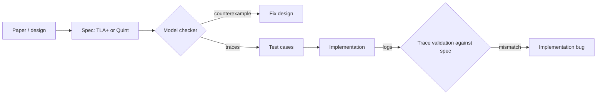

# Formal Methods and AI for Consensus

Testing samples behaviours. Model checking explores **all** behaviours of a model up to some bound. For consensus protocols, where bugs live in rare interleavings, that difference is decisive at the design level.

## Formal specification

TLA+ is widely used for consensus protocols (e.g. specs exist for Raft, Paxos variants, and Tendermint). Model checking explores all states up to bounds. Specs catch design bugs; they do not check that the implementation matches.

| Tool | Language | How it checks | Good for |
|---|---|---|---|
| TLC | TLA+ | explicit-state enumeration | small bounded models, readable counterexamples |
| Apalache | TLA+ / Quint | symbolic (SMT-based) bounded checking | larger parameter spaces, integers |
| Quint simulator | Quint | random simulation of the spec | quick exploration, trace generation |

## Bridging spec and implementation

- **Model-based testing:** generate test traces from the TLA+ model and replay them against the implementation (e.g. Informal Systems' work connecting Apalache/Quint models to Tendermint tests).
- **Trace validation:** log implementation behaviour and check it against the spec.



## Where AI helps

- Drafting TLA+/Quint specs from protocol papers (verify with model checking; humans review invariants).
- Generating scenarios targeting specific code paths (Chapter 3).
- Explaining counterexample traces.

As always: the model checker and the test harness decide; the model only proposes. The specific danger with AI-drafted specs is a **vacuous invariant**: one that is true of every state because it is weaker than intended, or a spec whose `Next` relation forbids the very behaviours that cause bugs. Guard against it by first introducing a known bug and confirming the checker finds it, exactly as in the worked example below.

## Worked example

> **Execution status:** The spec below was model-checked with TLC (from the `tla2tools.jar` published in the TLA+ GitHub releases) on Java while writing this chapter. The counterexample and the "no error" result described were observed.

Model the Chapter 2 bug in TLA+: a node that votes, crashes before persisting its vote, and votes again.

**Step 1: the spec** (`Votes.tla`):

```tla
------------------------------ MODULE Votes ------------------------------
EXTENDS Naturals, FiniteSets
CONSTANTS Nodes, Values, Q, Persist
VARIABLES mem, disk, sent

None == "none"
vars == <<mem, disk, sent>>

Init == /\ mem  = [n \in Nodes |-> None]
        /\ disk = [n \in Nodes |-> None]
        /\ sent = {}

Vote(n, v) == /\ mem[n] = None
              /\ mem'  = [mem EXCEPT ![n] = v]
              /\ disk' = IF Persist THEN [disk EXCEPT ![n] = v] ELSE disk
              /\ sent' = sent \cup {<<n, v>>}

Restart(n) == /\ mem' = [mem EXCEPT ![n] = disk[n]]
              /\ UNCHANGED <<disk, sent>>

Next == \E n \in Nodes : (\E v \in Values : Vote(n, v)) \/ Restart(n)

Committed(v) == Cardinality({n \in Nodes : <<n, v>> \in sent}) >= Q
Agreement == \A v, w \in Values : (Committed(v) /\ Committed(w)) => v = w

Spec == Init /\ [][Next]_vars
==========================================================================
```

**Step 2: the configuration** (`Votes.cfg`):

```
CONSTANTS
  Nodes = {n1, n2, n3, n4}
  Values = {A, B}
  Q = 3
  Persist = FALSE
SPECIFICATION Spec
INVARIANT Agreement
```

**Step 3: check it.**

```bash
java -XX:+UseParallelGC -cp tla2tools.jar tlc2.TLC -workers 2 Votes
```

With `Persist = FALSE`, TLC reported `Invariant Agreement is violated` and printed a nine-state trace: n1 votes A, restarts, votes B; n2 does the same; n3 votes A and n4 votes B. Both A and B then have three votes. With `Persist = TRUE`, TLC reported that model checking completed with no error, after exploring 81 distinct states.

Note the first draft of this spec failed to parse because it extended only `FiniteSets`, which does not define `>=`; `Naturals` is needed too. Tools catch such mistakes immediately, which is part of why AI-drafted specs must go through the checker before anyone trusts them.

**Step 4: connect to the implementation.** Each TLC counterexample is a schedule: which node votes, which restarts, in what order. Translate it into a scripted run of the Chapter 2 simulator (or, for a real client, a test that crashes the process at the corresponding points). If the implementation does not show the violation, either the spec is wrong or the implementation does something the spec does not model; both are worth knowing.

## Common pitfalls

- **Checking a spec that cannot fail.** Always plant a bug first and confirm the checker catches it.
- **Over-abstracting.** A spec without crashes cannot find crash-recovery bugs.
- **Bounds too small to matter.** Three nodes and one value may hide quorum-intersection bugs that need four nodes and two values.
- **Treating a passing model check as implementation proof.** It is evidence about the design only.
- **Letting the spec and code drift.** Re-run model-based tests on every protocol change.

## Exercises

1. Model your toy protocol from Chapter 2 in TLA+ or Quint and check safety.
2. Generate traces from the model and replay them against your implementation.
3. Ask a model to draft a spec for a simple leader election, then find its bugs with the model checker.
4. Extend the worked example with a `LoseFsync(n)` action that resets `disk[n]` to `None`, and check whether `Agreement` still holds with `Persist = TRUE`.

## Further reading

- TLA+: <https://lamport.azurewebsites.net/tla/tla.html>
- TLA+ tools releases: <https://github.com/tlaplus/tlaplus/releases>
- Quint: <https://github.com/informalsystems/quint>
- Apalache: <https://apalache-mc.org>
- Lamport, "Specifying Systems", Addison-Wesley, 2002
- See **neurosymbolic-contract-verification** for the propose-and-check pattern.
